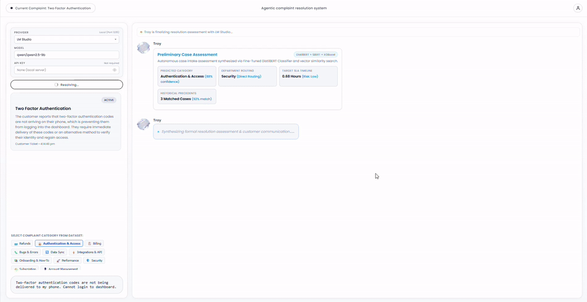

# Complaint Resolution Agent (CRA) — Troy

**Troy** is an autonomous AI agent designed to investigate, triage, and resolve customer complaints end-to-end. 

Rather than functioning as a traditional chatbot that offers generic canned responses or links to FAQs, Troy acts as an autonomous resolution specialist: he diagnoses issues, verifies live customer records, retrieves precedent solutions from hundreds of thousands of past tickets, and executes concrete remediations (such as issuing refunds, adjusting account balances, resetting locked accounts, or dispatching invoices) in real time.

---

## 🎥 Walkthrough: Meet Troy in Action

> Watch Troy autonomously triage a live complaint, verify customer transactional ledgers, cross-reference institutional precedents, and execute remediation in real time.

<div align="center">
  <a href="https://github.com/Pragadeesh-13/CRA/blob/master/docs/assets/About_Troy.mp4">
    
  </a>
  <p align="center">
    🎬 <strong><a href="https://github.com/Pragadeesh-13/CRA/blob/master/docs/assets/About_Troy.mp4">Click to Watch Full HD Walkthrough (About_Troy.mp4)</a></strong>
  </p>
</div>

---

## What Problem Does CRA Solve?

Customer support teams face a recurring challenge: high ticket volumes filled with predictable, actionable issues (double billing, proration disputes, account lockouts, API webhook timeouts). Human agents spend hours manually cross-referencing customer IDs, checking payment gateways, copying past precedents, and applying standard fixes.

CRA transforms this workflow into an **autonomous resolution pipeline**:
- **Zero-touch remediation for standard issues:** Troy identifies the root problem, inspects transactional databases, and applies the necessary fixes autonomously.
- **Institutional memory at scale:** Every new complaint is cross-referenced with 248,000+ historical precedents to ensure consistency and compliance with company policies.
- **Auditable and safe:** Troy verifies database states before taking action, enforces idempotency to prevent duplicate refunds, and documents every decision transparently for human operators.

---

## How It Works: The Resolution Lifecycle

When a customer submits a complaint, Troy guides the ticket through a 5-stage resolution process:

```
Customer Complaint
       │
       ▼
1. Triage & Classification ──► Identifies complaint category, urgency & department
       │
       ▼
2. Precedent Retrieval   ──► Searches 248,000+ historical cases for proven resolutions
       │
       ▼
3. Account Verification  ──► Inspects live transactions, order IDs & account status
       │
       ▼
4. Autonomous Execution  ──► Issues refunds, updates ledger, resets access, or syncs data
       │
       ▼
5. Customer Resolution   ──► Streams an empathetic, detailed resolution report to the user
```

1. **Intelligent Triage & Categorization**  
   Analyzes the customer's text to determine intent across 11 key operational domains (Billing, Refunds, Subscriptions, Security, Authentication, Bugs, System Performance, Data Sync, Integrations & APIs, Account Management, and Onboarding).

2. **Precedent Retrieval & Institutional Memory**  
   Semantically compares the incoming complaint against a vector database of **248,000+ historically resolved complaints**, identifying institutional precedents and benchmark resolution strategies with similarity confidence scores.

3. **System of Record & Ledger Investigation**  
   Extracts key references (Order numbers, User IDs, dates, monetary amounts) and queries live customer databases. Troy determines whether the customer actually experienced an erroneous charge, a system lock, or a service outage before taking action.

4. **Autonomous Remediation & Execution**  
   Executes real state updates directly against databases and service APIs:
   - Identifies duplicate debits and issues automated refunds via payment gateways.
   - Recalculates subscription tiers and credits prorated differences.
   - Clears failed login counters and initiates backup authentication codes.
   - Flushes message queues and adjusts API timeout thresholds.
   - *All actions are state-aware and idempotent: if a refund was already processed, Troy detects the existing refund ID rather than double-crediting.*

5. **Live Transparent Communication**  
   Troy live-streams his analytical thought process, data findings, and final empathetic resolution letter directly into an interactive console for real-time customer or operator visibility.

---

## Supported Complaint Scenarios

Troy comes pre-configured with resolution playbooks across multiple domains:

| Scenario | What Troy Investigates | Autonomous Action Executed |
|---|---|---|
| **Duplicate Subscription Debit** | Audits customer billing ledger across dates and order IDs | Detects duplicate settled transactions, initiates gateway refund, and updates ledger to clean standing. |
| **Prorated Tier Downgrade** | Compares active subscription tier with requested tier and invoice amount | Calculates proration delta ($50.00 difference) and credits customer account balance. |
| **2FA / SMS Gateway Lockout** | Checks user authentication logs for gateway delivery failures | Flushes SMS session locks and dispatches emergency backup OTP. |
| **API Webhook 504 Timeouts** | Inspects endpoint logs and delivery retry queues | Triggers webhook queue re-delivery and adjusts gateway retry thresholds. |
| **Corporate Tax & VAT Invoicing** | Checks enterprise customer tax ID and jurisdiction status | Generates compliant EU VAT reverse-charge tax invoice and attaches receipt. |
| **Department Routing & SLA Tracking** | Evaluates issue complexity, product line, and urgency | Routes ticket to Engineering, Billing, Security, or Tier 1 Support with SLA resolution timeframes. |

---

## The Interactive Operator Console

The CRA interface offers a complete command center for managing and observing complaints:

- **Live Streaming Resolution:** Watch Troy's reasoning unfold token-by-token as he verifies data, compares precedents, and formulates customer responses.
- **Customer Verification & Ledger Card:** Displays live before-and-after database records, customer metadata, and audit logs showing the exact timestamp and ID of actions taken.
- **Autonomous & Manual Modes:** Choose between full autonomous remediation by Troy or human-in-the-loop approval where operators review recommendations before executing changes.
- **Precedent Comparison Panel:** Review the exact historical tickets Troy referenced, including their match scores and original resolution notes.
- **Theme & Interface Controls:** Modern light and dark themes with real-time status indicators.

---

## Quickstart

### Prerequisites

- Python 3.11+
- (Optional) [LM Studio](https://lmstudio.ai/) for running local LLMs, or an API key for cloud providers (OpenAI, Anthropic, OpenRouter, Groq).

### 1. Installation

```bash
# Clone the repository
git clone https://github.com/Pragadeesh-13/CRA.git
cd CRA

# Create virtual environment
python -m venv .venv
.venv\Scripts\activate      # On Windows
# source .venv/bin/activate  # On Linux/macOS

# Install dependencies
pip install -r requirements.txt
```

### 2. Configuration

Create your `.env` file (or copy from `.env.example`):
```bash
cp .env.example .env
```

Configure your preferred LLM provider in `.env` (defaults to local LM Studio on port 1235, or set `LLM_PROVIDER=openai` / `anthropic` with your API key).

### 3. Launch the Application

```bash
python run.py
```

Open your browser at **http://localhost:3000** to enter the Complaint Resolution Agent console.

---

## Running Tests

Run the test suite to verify classification, precedent matching, database actions, and resolution workflows:

```bash
pytest
```

---

## License

This project is licensed under the MIT License.
